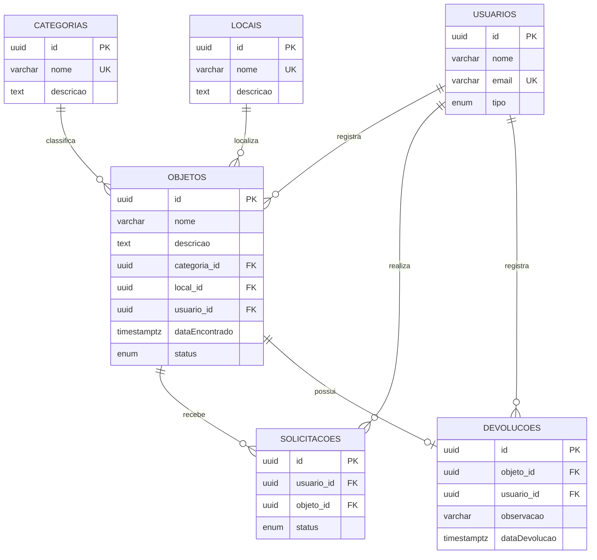

# Modelo de Dados — Sistema de Achados e Perdidos

## 1. Diagrama ER

O modelo possui seis entidades: Usuário, Objeto, Categoria, Local, Solicitação e Devolução.

A relação N-N entre Usuário e Objeto é representada pela entidade associativa Solicitação. Ela possui o atributo `status`, por isso foi modelada com duas relações 1-N (`@ManyToOne` e `@OneToMany`), em vez de um `@ManyToMany` direto.

## 2. Antes × Depois

| Antes | Depois | Justificativa |
|---|---|---|
| Identificadores numéricos na aplicação. | Identificadores UUID. | Evitar exposição de identificadores sequenciais nas URLs. |
| Referências entre registros sem relacionamentos explícitos em todas as entidades. | Relacionamentos com `@ManyToOne`, `@OneToMany` e `@OneToOne`. | Representar as relações do domínio. |
| Associação entre usuário e objeto sem representar adequadamente os dados da solicitação. | Entidade associativa Solicitação com status próprio. | Registrar e acompanhar as solicitações. |
| Regras de exclusão e integridade sem definição uniforme no modelo. | Chaves estrangeiras com `RESTRICT`. | Preservar registros relacionados. |
| Regras de unicidade a serem protegidas. | Restrições `unique` e restrição composta. | Evitar dados duplicados. |

## 3. Chaves estrangeiras e onDelete

| Relação | onDelete | Justificativa de negócio |
|---|---|---|
| Objeto → Categoria | RESTRICT | Impede excluir uma categoria utilizada por objetos cadastrados. |
| Objeto → Local | RESTRICT | Preserva a localização dos objetos registrados. |
| Objeto → Usuário | RESTRICT | Mantém a identificação de quem cadastrou o objeto. |
| Solicitação → Usuário | RESTRICT | Preserva o usuário responsável pela solicitação. |
| Solicitação → Objeto | RESTRICT | Preserva as solicitações vinculadas ao objeto. |
| Devolução → Objeto | RESTRICT | Evita perder o registro de devolução associado ao objeto. |
| Devolução → Usuário | RESTRICT | Preserva a identificação de quem registrou a devolução. |

Foi escolhido `RESTRICT` para impedir que a exclusão de um registro provoque a perda de informações importantes do sistema. As relações são obrigatórias (`nullable: false`), por isso `SET NULL` não é adequado.

## 4. Restrições de integridade

| Restrição | Regra protegida |
|---|---|
| `UNIQUE` em `categorias.nome` | Impede categorias com nomes duplicados. |
| `UNIQUE` em `locais.nome` | Impede locais com nomes duplicados. |
| `UNIQUE` em `usuarios.email` | Impede usuários com o mesmo e-mail. |
| `UQ_solicitacoes_usuario_objeto` | Impede que o mesmo usuário solicite o mesmo objeto mais de uma vez. |
| Unicidade de `devolucoes.objeto_id` | Impede mais de uma devolução para o mesmo objeto. |

A restrição composta de Solicitação foi definida com:

`@Unique('UQ_solicitacoes_usuario_objeto', ['usuario', 'objeto'])`

Além disso, as colunas foram revisadas: identificadores UUID, campos obrigatórios e opcionais com nulabilidade definida, tipos `enum` para situações e `timestamptz` para datas e horários. Não há campo monetário que necessite de `decimal`.
