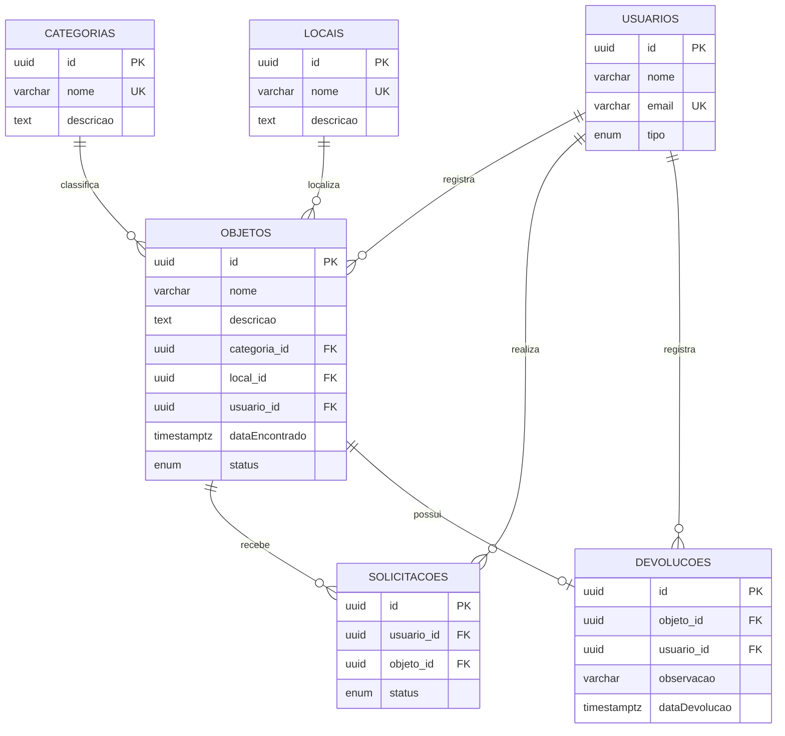

# Modelo de Dados — Sistema de Achados e Perdidos

## 1. Diagrama ER

O modelo possui seis entidades: Usuário, Objeto, Categoria, Local, Solicitação e Devolução.



A relação N-N entre Usuário e Objeto é representada pela entidade associativa Solicitação. Ela possui o atributo `status`, por isso foi modelada com duas relações 1-N (`@ManyToOne` e `@OneToMany`), em vez de um `@ManyToMany` direto.

## 2. Antes × Depois

| Antes | Depois | Justificativa |
|---|---|---|
| Identificadores numéricos na aplicação. | Identificadores UUID. | Evitar exposição de identificadores sequenciais nas URLs. |
| Referências entre registros sem relacionamentos explícitos em todas as entidades. | Relacionamentos com `@ManyToOne`, `@OneToMany` e `@OneToOne`. | Representar as relações do domínio. |
| Associação entre usuário e objeto sem representar adequadamente os dados da solicitação. | Entidade associativa Solicitação com status próprio. | Registrar e acompanhar as solicitações. |
| Regras de exclusão e integridade sem definição uniforme no modelo. | Chaves estrangeiras com `RESTRICT`. | Preservar registros relacionados. |
| Regras de unicidade a serem protegidas. | Restrições `unique` e restrição composta. | Evitar dados duplicados. |

## 3. Chaves estrangeiras e onDelete

| Relação | onDelete | Justificativa de negócio |
|---|---|---|
| Objeto → Categoria | RESTRICT | Impede excluir uma categoria utilizada por objetos cadastrados. |
| Objeto → Local | RESTRICT | Preserva a localização dos objetos registrados. |
| Objeto → Usuário | RESTRICT | Mantém a identificação de quem cadastrou o objeto. |
| Solicitação → Usuário | RESTRICT | Preserva o usuário responsável pela solicitação. |
| Solicitação → Objeto | RESTRICT | Preserva as solicitações vinculadas ao objeto. |
| Devolução → Objeto | RESTRICT | Evita perder o registro de devolução associado ao objeto. |
| Devolução → Usuário | RESTRICT | Preserva a identificação de quem registrou a devolução. |

Foi escolhido `RESTRICT` para impedir que a exclusão de um registro provoque a perda de informações importantes do sistema. As relações são obrigatórias (`nullable: false`), por isso `SET NULL` não é adequado.

## 4. Restrições de integridade

| Restrição | Regra protegida |
|---|---|
| `UNIQUE` em `categorias.nome` | Impede categorias com nomes duplicados. |
| `UNIQUE` em `locais.nome` | Impede locais com nomes duplicados. |
| `UNIQUE` em `usuarios.email` | Impede usuários com o mesmo e-mail. |
| `UQ_solicitacoes_usuario_objeto` | Impede que o mesmo usuário solicite o mesmo objeto mais de uma vez. |
| Unicidade de `devolucoes.objeto_id` | Impede mais de uma devolução para o mesmo objeto. |

A restrição composta de Solicitação foi definida com:

`@Unique('UQ_solicitacoes_usuario_objeto', ['usuario', 'objeto'])`

Além disso, as colunas foram revisadas: identificadores UUID, campos obrigatórios e opcionais com nulabilidade definida, tipos `enum` para situações e `timestamptz` para datas e horários. Não há campo monetário que necessite de `decimal`.

## 5. Verificação

### 5.1. Migrações

As migrações foram executadas no banco vazio achados_perdidos_verificacao. Foram identificadas nove migrações pendentes e todas foram executadas com sucesso.

Resumo da execução de migration:run no banco vazio achados_perdidos_verificacao:

```text
0 migrations are already loaded in the database.
9 migrations were found in the source code.
9 migrations are new migrations must be executed.

Migration CriarUsuarios1792722918383 has been executed successfully.
Migration AdicionarEntidadesMvp1792769989722 has been executed successfully.
Migration RelacionarUsuariosObjetosDevolucoes1792770928974 has been executed successfully.
Migration CadastrarCategoriasELocais1792774193231 has been executed successfully.
Migration AdicionarDescricaoCategoriasLocais1792800000000 has been executed successfully.
Migration AdicionarObservacaoDevolucoes1792900000000 has been executed successfully.
Migration CriarSolicitacoes1793000000000 has been executed successfully.
Migration ImpedirSolicitacoesDuplicadas1793100000000 has been executed successfully.
Migration ConverterIdsIntegerParaUuid1794005317985 has been executed successfully.
query: COMMIT
```


Também foi testado migration:revert, com reversão e reaplicação da última migração.

### 5.2. Listagem de objetos e relacionamentos

Foi realizada a requisição:

```powershell
curl.exe -i "http://localhost:3000/objetos"
```

Resultado: `HTTP 200 OK`.

A resposta apresentou 2 objetos, com paginação (`pagina: 1`, `limite: 10`).

O log SQL demonstrou o uso de `INNER JOIN` com as tabelas `categorias`, `locais` e `usuarios`. A listagem utilizou 2 consultas SQL: uma para selecionar os IDs paginados e outra para carregar os objetos e seus relacionamentos.

Assim, os relacionamentos são carregados em conjunto, sem consultas individuais para cada objeto, evitando o problema N+1.

### 5.3. Teste de restrição de duplicidade

Foi realizada uma tentativa de cadastrar novamente uma solicitação para o mesmo usuário e objeto:

```powershell
curl.exe -i -X POST http://localhost:3000/solicitacoes -H "Content-Type: application/json" -d '{"usuarioId":"651b20ef-5928-41dc-9474-fcca74d0d78b","objetoId":"ad4e0b40-61be-4f64-8cf5-a71e32e985fa","status":"pendente"}'
```

Resultado: `HTTP 409 Conflict`.

Resposta da API:

```json
{
  "message": "Este usuário já possui uma solicitação para este objeto",
  "error": "Conflict",
  "statusCode": 409
}
```

A API impediu o cadastro duplicado e tratou a violação da regra de negócio sem retornar erro interno `500`.
