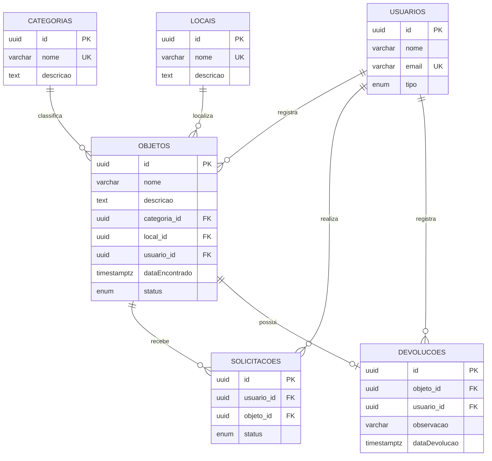

# Modelo de Dados — Sistema de Achados e Perdidos

## 1. Diagrama ER

O modelo possui seis entidades: Usuário, Objeto, Categoria, Local, Solicitação e Devolução.



A relação N-N entre Usuário e Objeto é representada pela entidade associativa Solicitação. Ela possui o atributo `status`, por isso foi modelada com duas relações 1-N (`@ManyToOne` e `@OneToMany`), em vez de um `@ManyToMany` direto.

## 2. Antes × Depois

| Antes | Depois | Justificativa |
|---|---|---|
| Identificadores numéricos na aplicação. | Identificadores UUID. | Evitar exposição de identificadores sequenciais nas URLs. |
| Referências entre registros sem relacionamentos explícitos em todas as entidades. | Relacionamentos com `@ManyToOne`, `@OneToMany` e `@OneToOne`. | Representar as relações do domínio. |
| Associação entre usuário e objeto sem representar adequadamente os dados da solicitação. | Entidade associativa Solicitação com status próprio. | Registrar e acompanhar as solicitações. |
| Regras de exclusão e integridade sem definição uniforme no modelo. | Chaves estrangeiras com `RESTRICT`. | Preservar registros relacionados. |
| Regras de unicidade a serem protegidas. | Restrições `unique` e restrição composta. | Evitar dados duplicados. |

## 3. Chaves estrangeiras e onDelete

| Relação | onDelete | Justificativa de negócio |
|---|---|---|
| Objeto → Categoria | RESTRICT | Impede excluir uma categoria utilizada por objetos cadastrados. |
| Objeto → Local | RESTRICT | Preserva a localização dos objetos registrados. |
| Objeto → Usuário | RESTRICT | Mantém a identificação de quem cadastrou o objeto. |
| Solicitação → Usuário | RESTRICT | Preserva o usuário responsável pela solicitação. |
| Solicitação → Objeto | RESTRICT | Preserva as solicitações vinculadas ao objeto. |
| Devolução → Objeto | RESTRICT | Evita perder o registro de devolução associado ao objeto. |
| Devolução → Usuário | RESTRICT | Preserva a identificação de quem registrou a devolução. |

Foi escolhido `RESTRICT` para impedir que a exclusão de um registro provoque a perda de informações importantes do sistema. As relações são obrigatórias (`nullable: false`), por isso `SET NULL` não é adequado.

## 4. Restrições de integridade

| Restrição | Regra protegida |
|---|---|
| `UNIQUE` em `categorias.nome` | Impede categorias com nomes duplicados. |
| `UNIQUE` em `locais.nome` | Impede locais com nomes duplicados. |
| `UNIQUE` em `usuarios.email` | Impede usuários com o mesmo e-mail. |
| `UQ_solicitacoes_usuario_objeto` | Impede que o mesmo usuário solicite o mesmo objeto mais de uma vez. |
| Unicidade de `devolucoes.objeto_id` | Impede mais de uma devolução para o mesmo objeto. |

A restrição composta de Solicitação foi definida com:

`@Unique('UQ_solicitacoes_usuario_objeto', ['usuario', 'objeto'])`

Além disso, as colunas foram revisadas: identificadores UUID, campos obrigatórios e opcionais com nulabilidade definida, tipos `enum` para situações e `timestamptz` para datas e horários. Não há campo monetário que necessite de `decimal`.

## 5. Verificação

### 5.1. Migrações

As migrações foram executadas no banco vazio achados_perdidos_verificacao. Foram identificadas nove migrações pendentes e todas foram executadas com sucesso.

Log completo do migration:run:

````text

> backend@0.0.1 migration:run
> tsx ./node_modules/typeorm/cli.js migration:run -d src/data-source.ts

query: SELECT version()
query: SELECT * FROM current_schema()
query: CREATE EXTENSION IF NOT EXISTS "uuid-ossp"
query: SELECT * FROM "information_schema"."tables" WHERE "table_schema" = $1 AND "table_name" = $2 -- PARAMETERS: ["public","migrations"]
query: CREATE TABLE "migrations" ("id" SERIAL NOT NULL, "timestamp" bigint NOT NULL, "name" character varying NOT NULL, CONSTRAINT "PK_8c82d7f526340ab734260ea46be" PRIMARY KEY ("id"))
query: SELECT * FROM "migrations" "migrations" ORDER BY "id" DESC
0 migrations are already loaded in the database.
9 migrations were found in the source code.
9 migrations are new migrations must be executed.
query: START TRANSACTION
query: CREATE TABLE "usuarios" ("id" SERIAL NOT NULL, "nome" character varying(150) NOT NULL, "email" character varying(255) NOT NULL, "tipo" character varying(20) NOT NULL, CONSTRAINT "UQ_446adfc18b35418aac32ae0b7b5" UNIQUE ("email"), CONSTRAINT "PK_d7281c63c176e152e4c531594a8" PRIMARY KEY ("id"))
query: INSERT INTO "migrations"("timestamp", "name") VALUES ($1, $2) -- PARAMETERS: [1792722918383,"CriarUsuarios1792722918383"]
Migration CriarUsuarios1792722918383 has been executed successfully.
query: CREATE TABLE "categorias" ("id" SERIAL NOT NULL, "nome" character varying(100) NOT NULL, CONSTRAINT "UQ_de8a2d8979f7820616e31dc1e15" UNIQUE ("nome"), CONSTRAINT "PK_3886a26251605c571c6b4f861fe" PRIMARY KEY ("id"))
query: CREATE TABLE "locais" ("id" SERIAL NOT NULL, "nome" character varying(150) NOT NULL, CONSTRAINT "UQ_64320ca4be574b81c57b95484bb" UNIQUE ("nome"), CONSTRAINT "PK_42eaed01557782613d36365d300" PRIMARY KEY ("id"))
query: CREATE TABLE "objetos" ("id" SERIAL NOT NULL, "nome" character varying(150) NOT NULL, "descricao" text NOT NULL, "dataEncontrado" TIMESTAMP NOT NULL, "status" character varying(20) NOT NULL DEFAULT 'encontrado', "categoria_id" integer NOT NULL, "local_id" integer NOT NULL, CONSTRAINT "PK_5f2898ccbd673819ed827b32a91" PRIMARY KEY ("id"))
query: CREATE TABLE "devolucoes" ("id" SERIAL NOT NULL, "dataDevolucao" TIMESTAMP NOT NULL DEFAULT now(), "objeto_id" integer NOT NULL, CONSTRAINT "REL_9ff892c612f28f70e177f5a387" UNIQUE ("objeto_id"), CONSTRAINT "PK_e89335b8032acafded142bbbff1" PRIMARY KEY ("id"))
query: ALTER TABLE "objetos" ADD CONSTRAINT "FK_1e1425c88011c24bdf5c17f4ebf" FOREIGN KEY ("categoria_id") REFERENCES "categorias"("id") ON DELETE NO ACTION ON UPDATE NO ACTION
query: ALTER TABLE "objetos" ADD CONSTRAINT "FK_44bf3f10332412700dcb7d98c76" FOREIGN KEY ("local_id") REFERENCES "locais"("id") ON DELETE NO ACTION ON UPDATE NO ACTION
query: ALTER TABLE "devolucoes" ADD CONSTRAINT "FK_9ff892c612f28f70e177f5a387b" FOREIGN KEY ("objeto_id") REFERENCES "objetos"("id") ON DELETE NO ACTION ON UPDATE NO ACTION
query: INSERT INTO "migrations"("timestamp", "name") VALUES ($1, $2) -- PARAMETERS: [1792769989722,"AdicionarEntidadesMvp1792769989722"]
Migration AdicionarEntidadesMvp1792769989722 has been executed successfully.
query: ALTER TABLE "objetos" ADD "usuario_id" integer NOT NULL
query: ALTER TABLE "devolucoes" ADD "usuario_id" integer NOT NULL
query: ALTER TABLE "objetos" ADD CONSTRAINT "FK_ea2eeedd230bea363eb01861857" FOREIGN KEY ("usuario_id") REFERENCES "usuarios"("id") ON DELETE NO ACTION ON UPDATE NO ACTION
query: ALTER TABLE "devolucoes" ADD CONSTRAINT "FK_bab7768fc5ef5a189f3ea9a91a3" FOREIGN KEY ("usuario_id") REFERENCES "usuarios"("id") ON DELETE NO ACTION ON UPDATE NO ACTION
query: INSERT INTO "migrations"("timestamp", "name") VALUES ($1, $2) -- PARAMETERS: [1792770928974,"RelacionarUsuariosObjetosDevolucoes1792770928974"]
Migration RelacionarUsuariosObjetosDevolucoes1792770928974 has been executed successfully.
query:
      INSERT INTO "categorias" ("nome")
      VALUES
        ('Eletr├┤nicos'),
        ('Documentos'),
        ('Material escolar'),
        ('Roupas e acess├│rios'),
        ('Chaves'),
        ('Outros')
      ON CONFLICT ("nome") DO NOTHING;

query:
      INSERT INTO "locais" ("nome")
      VALUES
        ('Biblioteca'),
        ('Laborat├│rio'),
        ('Sala de aula'),
        ('Cantina'),
        ('Área de convivência'),
        ('Outros')
      ON CONFLICT ("nome") DO NOTHING;

query: INSERT INTO "migrations"("timestamp", "name") VALUES ($1, $2) -- PARAMETERS: [1792774193231,"CadastrarCategoriasELocais1792774193231"]
Migration CadastrarCategoriasELocais1792774193231 has been executed successfully.
query:
      ALTER TABLE "categorias"
      ADD COLUMN "descricao" text

query:
      ALTER TABLE "locais"
      ADD COLUMN "descricao" text

query: INSERT INTO "migrations"("timestamp", "name") VALUES ($1, $2) -- PARAMETERS: [1792800000000,"AdicionarDescricaoCategoriasLocais1792800000000"]
Migration AdicionarDescricaoCategoriasLocais1792800000000 has been executed successfully.
query:
      ALTER TABLE "devolucoes"
      ADD COLUMN "observacao" character varying(500)

query: INSERT INTO "migrations"("timestamp", "name") VALUES ($1, $2) -- PARAMETERS: [1792900000000,"AdicionarObservacaoDevolucoes1792900000000"]
Migration AdicionarObservacaoDevolucoes1792900000000 has been executed successfully.
query:
      CREATE TABLE "solicitacoes" (
        "id" SERIAL NOT NULL,
        "usuario_id" integer NOT NULL,
        "objeto_id" integer NOT NULL,
        "status" character varying(20) NOT NULL DEFAULT 'pendente',
        CONSTRAINT "PK_solicitacoes" PRIMARY KEY ("id"),
        CONSTRAINT "FK_solicitacoes_usuario"
          FOREIGN KEY ("usuario_id")
          REFERENCES "usuarios"("id")
          ON DELETE NO ACTION
          ON UPDATE NO ACTION,
        CONSTRAINT "FK_solicitacoes_objeto"
          FOREIGN KEY ("objeto_id")
          REFERENCES "objetos"("id")
          ON DELETE NO ACTION
          ON UPDATE NO ACTION,
        CONSTRAINT "CHK_solicitacoes_status"
          CHECK ("status" IN ('pendente', 'aprovada', 'recusada'))
      )

query: INSERT INTO "migrations"("timestamp", "name") VALUES ($1, $2) -- PARAMETERS: [1793000000000,"CriarSolicitacoes1793000000000"]
Migration CriarSolicitacoes1793000000000 has been executed successfully.
query:
      ALTER TABLE "solicitacoes"
      ADD CONSTRAINT "UQ_solicitacoes_usuario_objeto"
      UNIQUE ("usuario_id", "objeto_id")

query: INSERT INTO "migrations"("timestamp", "name") VALUES ($1, $2) -- PARAMETERS: [1793100000000,"ImpedirSolicitacoesDuplicadas1793100000000"]
Migration ImpedirSolicitacoesDuplicadas1793100000000 has been executed successfully.
query: ALTER TABLE "usuarios" ADD COLUMN "id_uuid" uuid
query: UPDATE "usuarios" SET "id_uuid" = gen_random_uuid()
query: ALTER TABLE "usuarios" ALTER COLUMN "id_uuid" SET NOT NULL
query: ALTER TABLE "categorias" ADD COLUMN "id_uuid" uuid
query: UPDATE "categorias" SET "id_uuid" = gen_random_uuid()
query: ALTER TABLE "categorias" ALTER COLUMN "id_uuid" SET NOT NULL
query: ALTER TABLE "locais" ADD COLUMN "id_uuid" uuid
query: UPDATE "locais" SET "id_uuid" = gen_random_uuid()
query: ALTER TABLE "locais" ALTER COLUMN "id_uuid" SET NOT NULL
query: ALTER TABLE "objetos" ADD COLUMN "id_uuid" uuid
query: UPDATE "objetos" SET "id_uuid" = gen_random_uuid()
query: ALTER TABLE "objetos" ALTER COLUMN "id_uuid" SET NOT NULL
query: ALTER TABLE "devolucoes" ADD COLUMN "id_uuid" uuid
query: UPDATE "devolucoes" SET "id_uuid" = gen_random_uuid()
query: ALTER TABLE "devolucoes" ALTER COLUMN "id_uuid" SET NOT NULL
query: ALTER TABLE "solicitacoes" ADD COLUMN "id_uuid" uuid
query: UPDATE "solicitacoes" SET "id_uuid" = gen_random_uuid()
query: ALTER TABLE "solicitacoes" ALTER COLUMN "id_uuid" SET NOT NULL
query:
      ALTER TABLE objetos
        ADD COLUMN categoria_id_uuid uuid,
        ADD COLUMN local_id_uuid uuid,
        ADD COLUMN usuario_id_uuid uuid;

      ALTER TABLE devolucoes
        ADD COLUMN objeto_id_uuid uuid,
        ADD COLUMN usuario_id_uuid uuid;

      ALTER TABLE solicitacoes
        ADD COLUMN usuario_id_uuid uuid,
        ADD COLUMN objeto_id_uuid uuid;

query:
      UPDATE objetos o
      SET categoria_id_uuid = c.id_uuid
      FROM categorias c
      WHERE o.categoria_id = c.id;

      UPDATE objetos o
      SET local_id_uuid = l.id_uuid
      FROM locais l
      WHERE o.local_id = l.id;

      UPDATE objetos o
      SET usuario_id_uuid = u.id_uuid
      FROM usuarios u
      WHERE o.usuario_id = u.id;

      UPDATE devolucoes d
      SET objeto_id_uuid = o.id_uuid
      FROM objetos o
      WHERE d.objeto_id = o.id;

      UPDATE devolucoes d
      SET usuario_id_uuid = u.id_uuid
      FROM usuarios u
      WHERE d.usuario_id = u.id;

      UPDATE solicitacoes s
      SET objeto_id_uuid = o.id_uuid
      FROM objetos o
      WHERE s.objeto_id = o.id;

      UPDATE solicitacoes s
      SET usuario_id_uuid = u.id_uuid
      FROM usuarios u
      WHERE s.usuario_id = u.id;

query:
      DO $$
      BEGIN
        IF EXISTS (
          SELECT 1 FROM objetos
          WHERE categoria_id_uuid IS NULL
             OR local_id_uuid IS NULL
             OR usuario_id_uuid IS NULL
        ) OR EXISTS (
          SELECT 1 FROM devolucoes
          WHERE objeto_id_uuid IS NULL OR usuario_id_uuid IS NULL
        ) OR EXISTS (
          SELECT 1 FROM solicitacoes
          WHERE objeto_id_uuid IS NULL OR usuario_id_uuid IS NULL
        ) THEN
          RAISE EXCEPTION 'Falha ao converter relacionamentos para UUID';
        END IF;
      END $$;

query:
      ALTER TABLE objetos
        DROP CONSTRAINT "FK_1e1425c88011c24bdf5c17f4ebf",
        DROP CONSTRAINT "FK_44bf3f10332412700dcb7d98c76",
        DROP CONSTRAINT "FK_ea2eeedd230bea363eb01861857";

      ALTER TABLE devolucoes
        DROP CONSTRAINT "FK_9ff892c612f28f70e177f5a387b",
        DROP CONSTRAINT "FK_bab7768fc5ef5a189f3ea9a91a3",
        DROP CONSTRAINT "REL_9ff892c612f28f70e177f5a387";

      ALTER TABLE solicitacoes
        DROP CONSTRAINT "FK_solicitacoes_usuario",
        DROP CONSTRAINT "FK_solicitacoes_objeto",
        DROP CONSTRAINT "UQ_solicitacoes_usuario_objeto",
        DROP CONSTRAINT "CHK_solicitacoes_status";

query:
      ALTER TABLE usuarios
        DROP CONSTRAINT "PK_d7281c63c176e152e4c531594a8";

      ALTER TABLE categorias
        DROP CONSTRAINT "PK_3886a26251605c571c6b4f861fe";

      ALTER TABLE locais
        DROP CONSTRAINT "PK_42eaed01557782613d36365d300";

      ALTER TABLE objetos
        DROP CONSTRAINT "PK_5f2898ccbd673819ed827b32a91";

      ALTER TABLE devolucoes
        DROP CONSTRAINT "PK_e89335b8032acafded142bbbff1";

      ALTER TABLE solicitacoes
        DROP CONSTRAINT "PK_solicitacoes";

query:
      ALTER TABLE usuarios DROP COLUMN id;
      ALTER TABLE categorias DROP COLUMN id;
      ALTER TABLE locais DROP COLUMN id;
      ALTER TABLE objetos DROP COLUMN id;
      ALTER TABLE devolucoes DROP COLUMN id;
      ALTER TABLE solicitacoes DROP COLUMN id;

      ALTER TABLE usuarios RENAME COLUMN id_uuid TO id;
      ALTER TABLE categorias RENAME COLUMN id_uuid TO id;
      ALTER TABLE locais RENAME COLUMN id_uuid TO id;
      ALTER TABLE objetos RENAME COLUMN id_uuid TO id;
      ALTER TABLE devolucoes RENAME COLUMN id_uuid TO id;
      ALTER TABLE solicitacoes RENAME COLUMN id_uuid TO id;

      ALTER TABLE objetos DROP COLUMN categoria_id;
      ALTER TABLE objetos DROP COLUMN local_id;
      ALTER TABLE objetos DROP COLUMN usuario_id;

      ALTER TABLE objetos RENAME COLUMN categoria_id_uuid TO categoria_id;
      ALTER TABLE objetos RENAME COLUMN local_id_uuid TO local_id;
      ALTER TABLE objetos RENAME COLUMN usuario_id_uuid TO usuario_id;

      ALTER TABLE devolucoes DROP COLUMN objeto_id;
      ALTER TABLE devolucoes DROP COLUMN usuario_id;

      ALTER TABLE devolucoes RENAME COLUMN objeto_id_uuid TO objeto_id;
      ALTER TABLE devolucoes RENAME COLUMN usuario_id_uuid TO usuario_id;

      ALTER TABLE solicitacoes DROP COLUMN objeto_id;
      ALTER TABLE solicitacoes DROP COLUMN usuario_id;

      ALTER TABLE solicitacoes RENAME COLUMN objeto_id_uuid TO objeto_id;
      ALTER TABLE solicitacoes RENAME COLUMN usuario_id_uuid TO usuario_id;

query:
        ALTER TABLE "usuarios"
        ALTER COLUMN id SET DEFAULT gen_random_uuid()

query:
        ALTER TABLE "categorias"
        ALTER COLUMN id SET DEFAULT gen_random_uuid()

query:
        ALTER TABLE "locais"
        ALTER COLUMN id SET DEFAULT gen_random_uuid()

query:
        ALTER TABLE "objetos"
        ALTER COLUMN id SET DEFAULT gen_random_uuid()

query:
        ALTER TABLE "devolucoes"
        ALTER COLUMN id SET DEFAULT gen_random_uuid()

query:
        ALTER TABLE "solicitacoes"
        ALTER COLUMN id SET DEFAULT gen_random_uuid()

query:
      ALTER TABLE usuarios ADD CONSTRAINT PK_usuarios PRIMARY KEY (id);
      ALTER TABLE categorias ADD CONSTRAINT PK_categorias PRIMARY KEY (id);
      ALTER TABLE locais ADD CONSTRAINT PK_locais PRIMARY KEY (id);
      ALTER TABLE objetos ADD CONSTRAINT PK_objetos PRIMARY KEY (id);
      ALTER TABLE devolucoes ADD CONSTRAINT PK_devolucoes PRIMARY KEY (id);
      ALTER TABLE solicitacoes ADD CONSTRAINT PK_solicitacoes PRIMARY KEY (id);

query:
      CREATE TYPE usuarios_tipo_enum AS ENUM ('aluno', 'docente');
      CREATE TYPE objetos_status_enum AS ENUM ('encontrado', 'devolvido');
      CREATE TYPE solicitacoes_status_enum AS ENUM ('pendente', 'aprovada', 'recusada');

      ALTER TABLE usuarios
        ALTER COLUMN tipo TYPE usuarios_tipo_enum USING tipo::usuarios_tipo_enum;

      ALTER TABLE objetos
        ALTER COLUMN status DROP DEFAULT;

      ALTER TABLE objetos
        ALTER COLUMN status TYPE objetos_status_enum USING status::objetos_status_enum;

      ALTER TABLE objetos
        ALTER COLUMN status SET DEFAULT 'encontrado';

      ALTER TABLE solicitacoes
        ALTER COLUMN status DROP DEFAULT;

      ALTER TABLE solicitacoes
        ALTER COLUMN status TYPE solicitacoes_status_enum USING status::solicitacoes_status_enum;

      ALTER TABLE solicitacoes
        ALTER COLUMN status SET DEFAULT 'pendente';

      ALTER TABLE objetos
        ALTER COLUMN "dataEncontrado" TYPE timestamptz
        USING "dataEncontrado" AT TIME ZONE 'UTC';

      ALTER TABLE devolucoes
        ALTER COLUMN "dataDevolucao" DROP DEFAULT;

      ALTER TABLE devolucoes
        ALTER COLUMN "dataDevolucao" TYPE timestamptz
        USING "dataDevolucao" AT TIME ZONE 'UTC';

      ALTER TABLE devolucoes
        ALTER COLUMN "dataDevolucao" SET DEFAULT now();

query:
      ALTER TABLE objetos
        ADD CONSTRAINT FK_objetos_categoria
          FOREIGN KEY (categoria_id) REFERENCES categorias(id) ON DELETE RESTRICT,
        ADD CONSTRAINT FK_objetos_local
          FOREIGN KEY (local_id) REFERENCES locais(id) ON DELETE RESTRICT,
        ADD CONSTRAINT FK_objetos_usuario
          FOREIGN KEY (usuario_id) REFERENCES usuarios(id) ON DELETE RESTRICT;

      ALTER TABLE devolucoes
        ADD CONSTRAINT FK_devolucoes_objeto
          FOREIGN KEY (objeto_id) REFERENCES objetos(id) ON DELETE RESTRICT,
        ADD CONSTRAINT FK_devolucoes_usuario
          FOREIGN KEY (usuario_id) REFERENCES usuarios(id) ON DELETE RESTRICT,
        ADD CONSTRAINT UQ_devolucoes_objeto UNIQUE (objeto_id);

      ALTER TABLE solicitacoes
        ADD CONSTRAINT FK_solicitacoes_usuario
          FOREIGN KEY (usuario_id) REFERENCES usuarios(id) ON DELETE RESTRICT,
        ADD CONSTRAINT FK_solicitacoes_objeto
          FOREIGN KEY (objeto_id) REFERENCES objetos(id) ON DELETE RESTRICT,
        ADD CONSTRAINT UQ_solicitacoes_usuario_objeto
          UNIQUE (usuario_id, objeto_id);

query: INSERT INTO "migrations"("timestamp", "name") VALUES ($1, $2) -- PARAMETERS: [1794005317985,"ConverterIdsIntegerParaUuid1794005317985"]
Migration ConverterIdsIntegerParaUuid1794005317985 has been executed successfully.
query: COMMIT

````

Também foi testado migration:revert, com reversão e reaplicação da última migração.

### 5.2. Listagem de objetos e relacionamentos

Foi realizada a requisição:

```powershell
curl.exe -i "http://localhost:3000/objetos"
```

Resultado: `HTTP 200 OK`.

A resposta apresentou 2 objetos, com paginação (`pagina: 1`, `limite: 10`).

O log SQL demonstrou o uso de `INNER JOIN` com as tabelas `categorias`, `locais` e `usuarios`. A listagem utilizou 2 consultas SQL: uma para selecionar os IDs paginados e outra para carregar os objetos e seus relacionamentos.

Assim, os relacionamentos são carregados em conjunto, sem consultas individuais para cada objeto, evitando o problema N+1.

### 5.3. Teste de restrição de duplicidade

Foi realizada uma tentativa de cadastrar novamente uma solicitação para o mesmo usuário e objeto:

```powershell
curl.exe -i -X POST http://localhost:3000/solicitacoes -H "Content-Type: application/json" -d '{"usuarioId":"651b20ef-5928-41dc-9474-fcca74d0d78b","objetoId":"ad4e0b40-61be-4f64-8cf5-a71e32e985fa","status":"pendente"}'
```

Resultado: `HTTP 409 Conflict`.

Resposta da API:

```json
{
  "message": "Este usuário já possui uma solicitação para este objeto",
  "error": "Conflict",
  "statusCode": 409
}
```

A API impediu o cadastro duplicado e tratou a violação da regra de negócio sem retornar erro interno `500`.
